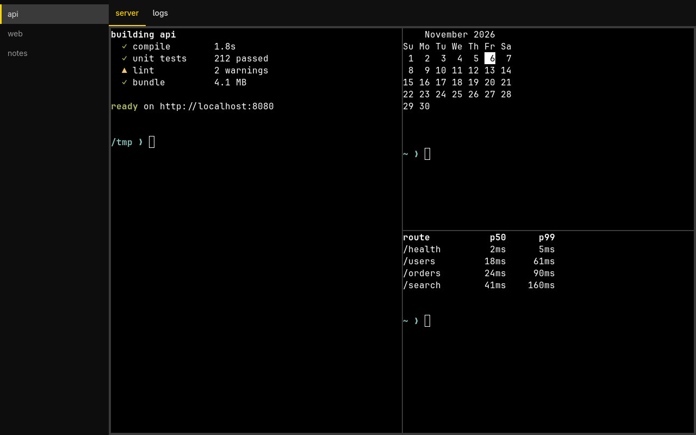
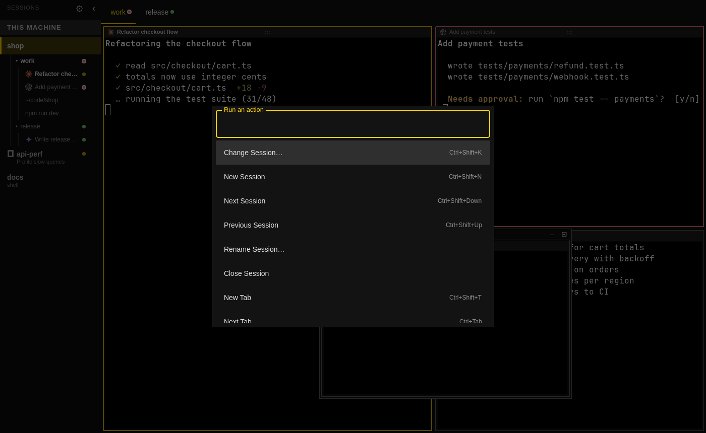
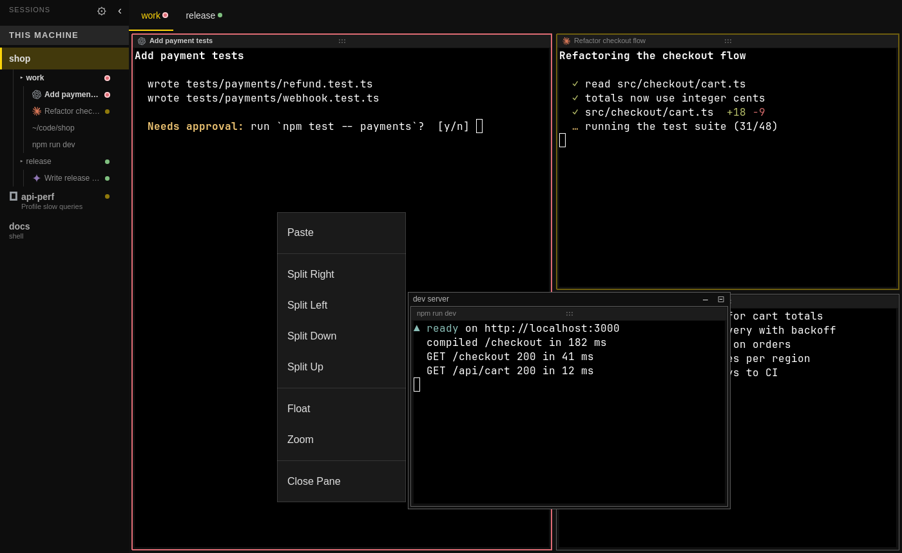
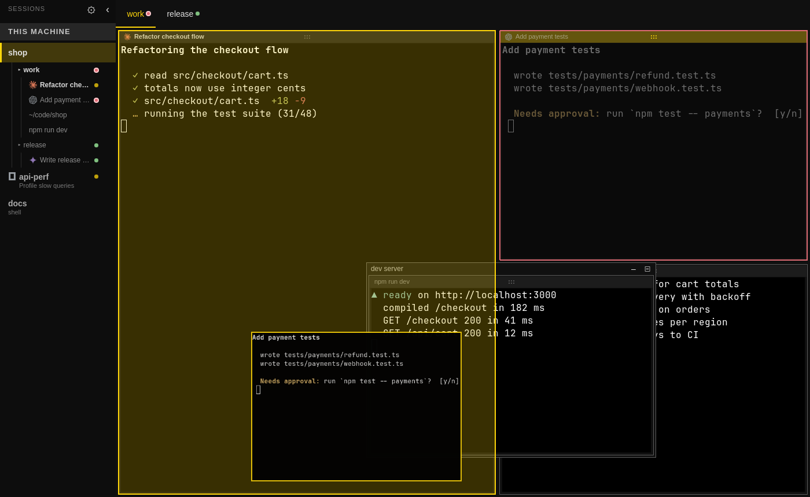
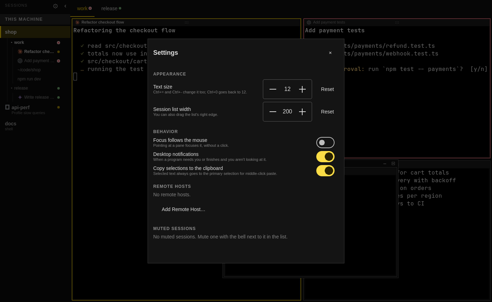
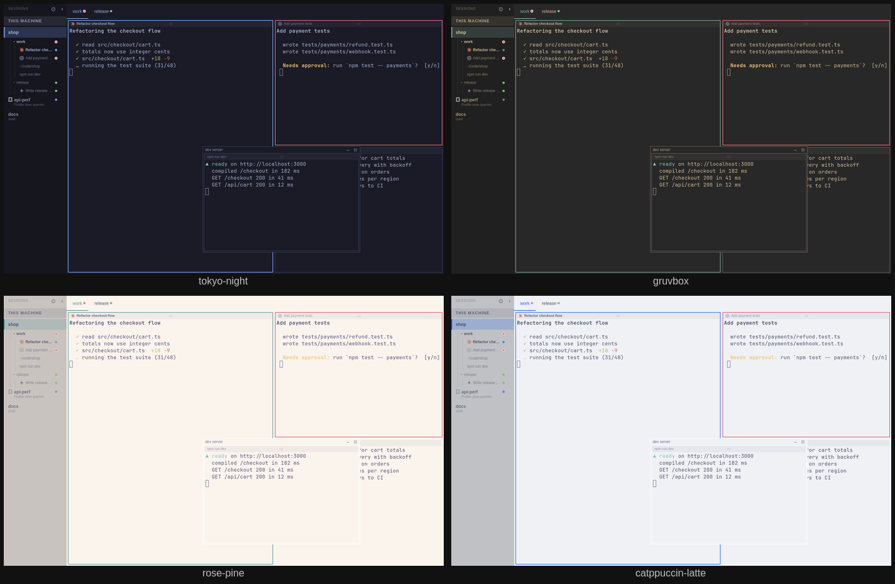

# orex



Rex on Omarchy, shortened to orex. [Rex](https://superlogical.com) keeps
terminal sessions running on a server, and its Mac and iOS apps show them. Rex has
no Linux client yet, so orex is one for [Omarchy](https://omarchy.org): it shows
the sessions of this machine's Rex server and of the other hosts in `rex hosts`,
with their tabs, splits, and floating panes, and keeps them in step with whatever
the Mac app does to the same sessions.

> orex is an unofficial client. It isn't made by or affiliated with Superlogical.
> It speaks the API that Rex servers document at `/llms.txt`, which is still in
> beta and may change under it.

The terminal is [libghostty-vt](https://ghostty.org), the core Rex itself uses, so
orex reads Rex's terminal snapshots directly and draws what the program in each pane
draws. Colors follow the Omarchy theme, and orex hands that palette to Rex, so
programs that ask the terminal for its colors get the ones you see.

## Use

```sh
rex new work        # if the server has no sessions yet
orex                # opens the first session
orex work           # opens the session labeled "work"
```

orex connects to `$REX_SERVER`, or to the local server's socket at
`/run/user/$UID/rex/server.sock`.

When orex shows a pane, it becomes the pane's owner, so the pane takes the size of
orex's window. The Mac app's view of that pane is resized until orex closes and gives
it back.

## Keys

Ctrl+Shift+P lists every action with its key, so you can search for one.



| Key | Does |
|---|---|
| Ctrl+Shift+] / Ctrl+Shift+[ | Next / previous tab |
| Ctrl+Shift+Down / Ctrl+Shift+Up | Next / previous session |
| Ctrl+Shift+B | Show or hide the session list |
| Ctrl+Shift+C | Copy the selection |
| Ctrl+Shift+V, Shift+Insert | Paste the clipboard |
| Middle click | Paste the primary selection |
| Shift+PageUp / Shift+PageDown | Scroll back / forward a page |
| Shift+drag | Select, even when the program uses the mouse |
| Ctrl+= / Ctrl+- / Ctrl+0 | Bigger / smaller / default text |

Programs that report their status (Claude Code does, with OSC 7501) show it
on their pane's border, in the session list, and on the tab: working pulses,
blocked is red, done is green. When one needs you or finishes and you aren't
looking at it, orex sends a desktop notification; its Open button takes you
there. Click the bell on a session in the list to mute its notifications (🔕);
its status still shows in orex.

Right-click a pane for copy, paste, split, float, zoom, and close; they act on
that pane. Click a pane to focus it. Everything else goes to the program in the pane.



With more than one pane, a pane's title bar is its handle. Drag it onto
another pane: near an edge puts it on that side, the middle swaps the two.
Panes move between the layout and floating windows the same way. Drag the
border between two panes to resize them.



## Settings

The gear at the top of the session list (or Ctrl+,) opens every setting: text
size, list width, focus following the mouse, desktop notifications, copying
selections to the clipboard, remote hosts, and muted sessions. Changes apply
right away.



## Themes

orex takes its colors from the current Omarchy theme and follows it while it
runs. Switch themes and the session list, tabs, pane borders, status colors, and
the terminals change with it, light themes included. Corners follow Hyprland's
rounding. Without Omarchy, orex uses a dark default.



## Build

orex needs Qt 6 (base, declarative, wayland) and the `ghostty` package, which
installs libghostty-vt.

```sh
bin/build           # build/orex
bin/install         # builds the package and installs it, so orex is in the launcher
```

## Not yet

Kitty images, rectangular selection, a scrollbar, resizing panes from the
keyboard, and resuming a stream after a dropped connection (orex reconnects from
scratch when a server restarts or a machine wakes up).

## Agent icons

The session list marks panes running a coding agent with its icon. Claude,
OpenAI (Codex), GitHub Copilot, Google Gemini, OpenCode, and Kimi come from
[Simple Icons](https://simpleicons.org) (CC0); the marks belong to their owners.
Hermes uses the icon its desktop app installs, when it's there.

## License

MIT. See [LICENSE](LICENSE).
